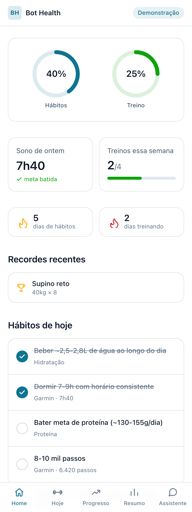
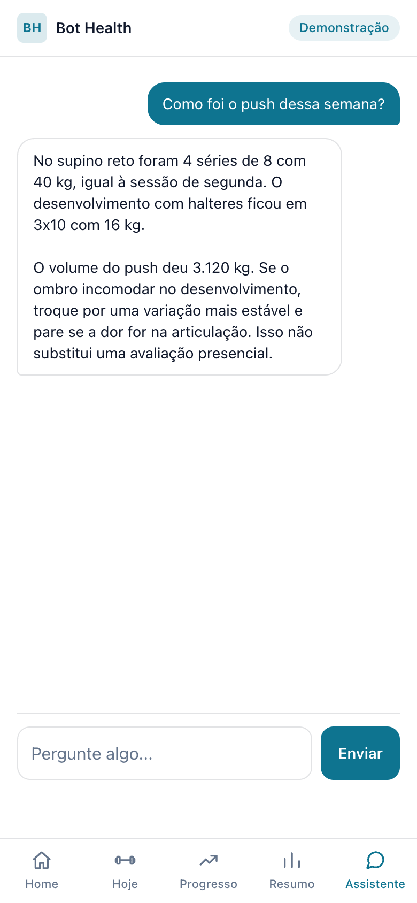
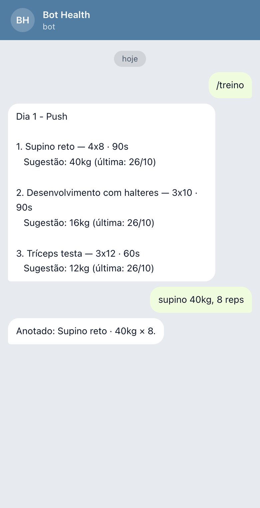
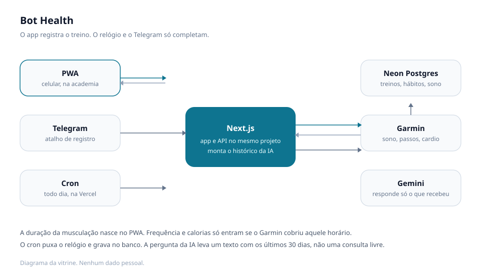

# Bot Health

App de treino e saúde que uso todos os dias: PWA mobile-first, bot no Telegram e um assistente de IA que lê o meu histórico para responder.

**No ar:** https://bot-health.vercel.app · **Vídeo:** [demo.mp4](docs/demo.mp4) (60 segundos, dados fictícios, sem narração)

> O código-fonte é privado porque o app guarda dados pessoais de saúde. Este repositório documenta a arquitetura e as decisões, com capturas de tela de dados fictícios.

## Problema

Registrar treino e saúde exige vários apps, e nenhum responde com base no meu próprio histórico.

## O que faz

- Registro de treinos e métricas de saúde pelo app (PWA, pensado para uso no celular, na academia).
- Bot no Telegram para registrar e consultar sem abrir o app.
- Assistente de IA (Gemini) que lê o histórico do usuário e responde com base nele.
- Importa dados do Garmin por tarefa agendada (cron).

## Arquitetura

O celular fala com o Next.js. O Telegram entra pelo webhook. Uma vez por dia, o cron puxa sono, passos e cardio do Garmin e grava no Neon. Quando alguém pergunta ao assistente, a API monta um texto com a ficha e os últimos 30 dias e manda isso ao Gemini.

## Decisões técnicas

- **Next.js 16 + TypeScript** para app e API no mesmo projeto.
- **Drizzle + Neon Postgres** para o banco com tipos.
- **PWA mobile-first**, porque o uso real é no celular.
- **A musculação é registrada no app.** A duração da sessão nasce ali. Frequência e calorias só são anexadas se uma atividade do Garmin cobre o mesmo horário por pelo menos 3 minutos. Corrida e natação continuam sendo cardio e não entram na sessão de força. Sem relógio, o treino continua válido.
- **O assistente não consulta o banco na hora de responder.** Cada pergunta recebe um texto já montado (ficha, hábitos e os últimos 30 dias). A instrução pede para usar esses números e dizer quando o dado não está lá, em vez de completar a lacuna. Tema de dor ou lesão termina com a ressalva de que aquilo não substitui avaliação presencial.

## Resultado

Em uso desde agosto de 2026: 76 dias com métricas corporais, 79 séries de musculação anotadas e 17 sessões de cardio importadas do relógio.

## Stack

Next.js 16, TypeScript, Drizzle, Neon Postgres, PWA, Telegram Bot API, Gemini API, cron.
